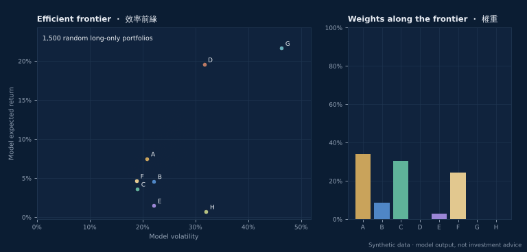
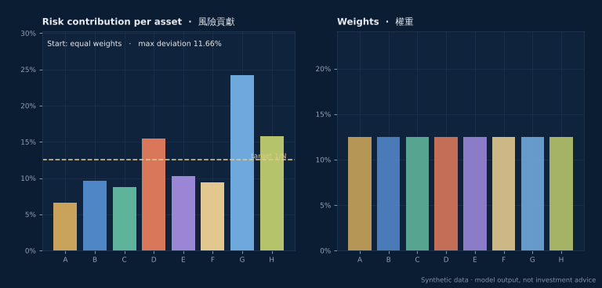
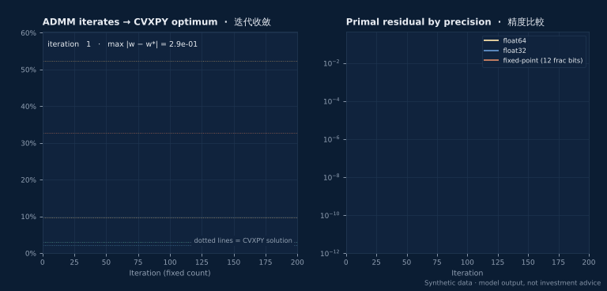

# Portfolio Optimization Lab · 投資組合優化實驗室

An open-source Python toolkit for **mean-variance** and **risk-parity** portfolio optimization built on [CVXPY](https://www.cvxpy.org/). Research direction: **hardware acceleration (FPGA / ASIC) of convex optimization** for low-latency portfolio rebalancing.

以 [CVXPY](https://www.cvxpy.org/) 實現**均值-方差**及**風險平價**投資組合優化的開源 Python 工具庫。研究方向：以**硬件加速（FPGA / ASIC）**凸優化運算，實現低延遲投資組合再平衡。

**Status · 狀態:** In development · 開發中<br>
**Interactive demo · 互動示範:** https://tylercheng00.github.io/portfolio-optimization-lab/

> **Disclaimer · 免責聲明** — For research and educational purposes only; not investment advice. All examples and figures use **synthetic data** generated by the library; they illustrate how the algorithms behave and are not a track record or a forecast.<br>
> 僅供研究及教育用途，不構成投資建議。所有示例及圖表均使用程式生成的**模擬數據**，只用於說明演算法的運作，並非任何往績或預測。

---

## What it does · 功能

### Efficient frontier · 效率前緣

CVXPY solves a minimum-variance problem for each target return; the weights morph as the portfolio moves along the curve.<br>
CVXPY 在每個目標回報下求解最小方差問題；組合沿曲線移動時，權重隨之變化。



### Risk parity · 風險平價

Coordinate descent drives every asset's share of portfolio risk to the same 1/N target, starting from equal weights.<br>
由等權重出發，坐標下降法令每項資產對組合風險的貢獻收斂至相同的 1/N。



### Fixed-iteration ADMM kernel · 固定迭代 ADMM 核心

A NumPy reference model of the solver data path studied for hardware: pre-factorised KKT matrix, then only matrix-vector products, clamps and additions for a fixed number of iterations. It can emulate `float32` and fixed-point arithmetic to study precision vs. convergence.<br>
用於硬件研究的求解器數據通路 NumPy 參考模型：預先分解 KKT 矩陣，之後每次迭代只涉及矩陣向量乘法、截斷及加法，迭代次數固定。可模擬 `float32` 及定點數運算，研究精度與收斂的關係。



| Module · 模組 | Contents · 內容 |
|---|---|
| `mean_variance` | `min_variance`, `target_return`, `risk_aversion`, `max_sharpe` (convex reformulation), `efficient_frontier`; long-only or custom weight bounds |
| `risk_parity` | `risk_parity` (convex log-barrier formulation, CVXPY), `risk_parity_ccd` (closed-form coordinate descent), `risk_contributions`, custom risk budgets |
| `rebalance` | Rebalancing with an L1 transaction-cost penalty and optional turnover cap |
| `estimators` | Annualized mean, sample covariance, Ledoit–Wolf shrinkage |
| `admm` | Fixed-iteration ADMM reference kernel with `float64` / `float32` / fixed-point emulation |
| `data` | Synthetic factor-model market generator (no real data) |

## Quickstart · 快速上手

```bash
git clone https://github.com/tylercheng00/portfolio-optimization-lab.git
cd portfolio-optimization-lab
pip install -e ".[dev]"
python examples/quickstart.py
pytest
```

```python
import numpy as np
import portfolio_lab as pl

market = pl.synthetic_market(n_assets=8, seed=0)          # synthetic data only
mu = pl.mean_returns(market.returns)
cov, _ = pl.ledoit_wolf_covariance(market.returns)

w_ms = pl.max_sharpe(mu, cov).weights                       # mean-variance
w_rp = pl.risk_parity(cov)                                  # equal risk contributions
current = np.full(market.n_assets, 1 / market.n_assets)
trade = pl.rebalance(current, mu, cov, gamma=3.0, cost=0.002)
admm = pl.mean_variance_admm(mu, cov, gamma=3.0, n_iter=300, precision="float32")
```

To regenerate the animated figures and the demo data · 重新生成動畫圖表及示範數據：

```bash
pip install -e ".[figures]"
python scripts/make_figures.py
```

## Research direction · 研究方向

Low-latency rebalancing needs a solver whose run time is **predictable**, not just fast on average. The project explores how far a convex portfolio QP can be pushed onto pipelined hardware:

1. **Fixed-latency algorithm** — ADMM with a pre-factorised KKT system and a fixed iteration count (implemented here as a software reference model).
2. **Numeric precision** — how word length (`float32`, fixed-point) trades accuracy against chip area (emulated here in NumPy).
3. **Hardware mapping** — mapping the matrix-vector / clamp / dual-update stages onto FPGA or ASIC pipelines (future work; **no hardware has been built**).

低延遲再平衡需要運行時間**可預測**的求解器，而不只是平均速度快。本項目探索如何把凸優化投資組合問題映射到流水線式硬件：

1. **固定延遲演算法**：預先分解 KKT 系統、迭代次數固定的 ADMM（本代碼庫已有軟件參考模型）。
2. **數值精度**：字長（`float32`、定點數）如何在精度與晶片面積之間取捨（本代碼庫以 NumPy 模擬）。
3. **硬件映射**：把矩陣向量乘法、截斷及對偶更新映射到 FPGA 或 ASIC 流水線（未來工作，**尚未製作任何硬件**）。

## Roadmap · 路線圖

- [x] Mean-variance, max Sharpe and efficient frontier (CVXPY)
- [x] Risk parity / risk budgeting (CVXPY + coordinate descent)
- [x] Transaction-cost-aware rebalancing
- [x] Fixed-iteration ADMM reference kernel with precision emulation
- [x] Interactive demo page and animated figures
- [ ] Factor-model and robust covariance estimators
- [ ] Bit-accurate fixed-point model of the ADMM kernel
- [ ] HLS / RTL prototype of the solver pipeline (research)

## Privacy · 私隱

The repository contains no real market data, client data, account information or personal data. Every number is produced by `portfolio_lab.synthetic_market`.<br>
本代碼庫不包含任何真實市場數據、客戶資料、帳戶資料或個人資料，所有數字均由 `portfolio_lab.synthetic_market` 生成。

## License · 授權

MIT — see [LICENSE](LICENSE).

---

By 鄭迪珉 Tyler Tik Man Cheng · [tylercheng00.github.io](https://tylercheng00.github.io/)
